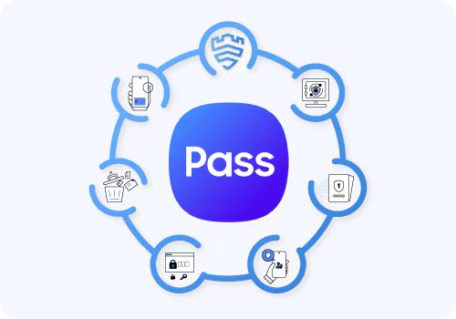

# Passwortmanager

# Leitfrage:
Welchem Passwortmanager vertraue ich eigentlich täglich meine wichtigen Passwörter an?
Microsoft Edge Passwortmanager / Samsung Pass / Google Passwortmanager

- Was möchte ich zeigen oder klären? 

was ist für mich der beste Passwortmanager

  · johannes.vervoort, 9d

---

# Wozu benötige ich einen Passwortmanager

1. **Was ist ein Passwortmanager?**
Der Passwortmanager ist ein Programm, das Zugangsdaten verschlüsselt an einem sichereren Ort abspeichert.  Viele dieser Programme bieten auch die Möglichkeit, Passwörter automatisch zu erstellen. Dies soll die Sicherheit erhöhen.

2. **Welche Probleme löst ein Passwortmanager?**
Für jedes Konto im Internet sollte man ein anderes Passwort verwenden. Da ich mir aber nicht viele Passwörter merken kann, übernimmt der Passwortmanager diese Aufgabe. Ich brauche dann nur noch ein Masterpasswort für den Passwortmanager.
3. **Warum brauche ich überhaupt ein sicheres Passwort?**
Ein sicheres Passwort schützt meine Daten vor Angriffen von Hackern oder anderen unbefugten Zugriffen. Wenn ich für viele verschiedene Onlinekonten dasselbe Passwort benutze, werden bei einem Passwortdiebstahl direkt viele meiner Konten im Internet bedroht.

---

# Meine drei Fragen

1. **Wo finde ich den Passwortmanager?**
- Mir ist wichtig zu erfahren, ob es mir leicht gemacht wird, meine wichtigen Daten gut zu schützen. Wenn das schon zu kompliziert ist, möchte ich lieber einen einfacheren Manager haben.
1.  **Welchen Funktionsumfang hat der Passwortmanager?**
- Ich frage mich, wie gut meine Daten geschützt werden und welche Möglichkeiten mir für den Zugriff geboten werden.
1. **Wie viel kostet der Passwortmanager?**
- Ist der Schutz meiner Passwörter kostenlos, oder verlangen die Anbieter für diesen Schutz Geld? Und wenn ja, wie viel?

---

# Meine drei meistgenutzten Passwortmanager

  

  **Microsoft Edge Passwortmanager**

 Der Microsoft Edge Passwortmanager gehört zu Microsoft und ist direkt im Edge-Browser verfügbar. Er ist Bestandteil des Browsers und benötigt keine zusätzliche Installation.
  

  

  

  **Samsung Pass**

Samsung Pass ist ein Passwortmanager von Samsung Electronics. Er wurde speziell für Samsung-Geräte entwickelt.  Mit ihm kann ich mich unter anderem mit biometrischen Merkmalen wie dem Fingerabdruck anmelden.
  
  

  

 **Google Passwortmanager**

Der Google Passwortmanager ist von Google. Er ist in Google Chrome und Android integriert und kann gespeicherte Passwörter über das Google-Konto zwischen unterstützten Geräten synchronisieren – z.B. kann er ein Passwort auch auf mehreren Geräten abgleichen.
  
  

---

# Meine Passwortmanager im Vergleich

  

  **Wo finde ich den Manager?**
  **Microsoft Edge Passwortmanager:** Direkt im Browser Microsoft Edge
  **Sammsung Pass:** Auf unterstützten Samsunggeräten
  **Google passwortmanager:** Direkt im Browser Google-Chrome und in Android

  

  

  **Welchen Funktionsumfang hat der Passwortmanager?** 
  **Microsoft Edge Passwortmanager:** Speichert Passwörter und füllt Anmeldedaten automatisch aus. Unterstütz auch Passkeys: Gesicht, Fingerabdruck oder 
  Pin* 2FA-fähig
  **Sammsung Pass:** Biometrischer Authentifizierungsdienst Anmeldung per Fingerabdruck, Pin, Iris-Erkennung, Gesichtserkennung, Muster und Passwort* 2FA-fähig
  **Google passwortmanager:** Speichert Passwörter und füllt sie automatisch aus* 2FA-fähig

 

 

  **Wie viel kostet der Passwortmanager?** 
  **Microsoft Edge Passwortmanager:** Kostenlos nutzbar
  **Sammsung Pass:** Kostenlos nutzbar
  **Google passwortmanager:** Kostenlos nutzbar

  

 *Funktionsumfang abhängig von Gerät und Plattform

---

# Allgemeine Informationen über Samsung Pass 

1. **Wo finde ich Samsung Pass?**
•	Samsung Pass ist auf unterstützten Samsung-Galaxy-Geräten verfügbar.
•	Auf neueren Geräten ist Samsung Pass in die App Samsung Wallet integriert.
2. **Welche Funktionen bietet Samsung Pass?**
•	Speichert Benutzernamen und Passwörter.
•	Fügt gespeicherte Anmeldedaten automatisch ein.
•	Ermöglicht die Anmeldung per Fingerabdruck oder 
3. **Wie viel kostet Samsung Pass?**
•	Samsung Pass ist kostenlos nutzbar.
•	Für die Passwortverwaltung ist kein zusätzliches kostenpflichtiges Abonnement erforderlich.

---
# Wie schützt Samsung Pass meine Passwörter?

  

  **Anmeldung mit Fingerabdruck**

  -  Statt ein Passwort einzutippen, kann ich mich auf unterstützten Geräten mit meinem Fingerabdruck anmelden.
  So muss ich meine gespeicherten Zugangsdaten nicht jedes Mal selbst eingeben.

  

  

  **Zwei-Faktor-Authentifizierung: 2FA**

  -  Das Samsung-Konto kann mit einer zusätzlichen Sicherheitsabfrage geschützt werden.
  neben dem Passwort wird dann eine zweite Bestätigung benötigt, beispielsweise über das Smartphone.

  

  

  **Samsung Pass als 2FA-Hilfe**

  - Samsung Pass kann zusätzliche Sicherheitscodes für bestimmte Websites und Apps erzeugen.
Diese Codes ändern sich regelmäßig und dienen als weiterer Schutz bei der Anmeldung.
Wichtig zu wissen: Ein Fingerabdruck allein ist noch keine Zwei-Faktor-Authentifizierung.

 

---

# Mein Fazit

Ich habe mich dafür entschieden, den Samsung Pass genauer zu untersuchen, weil ich von den drei genannten Passwortmanagern diesen am häufigsten verwende, weil ich mein Smartphone öfters nutze als meinen PC. Darum war mir wichtig, herauszufinden, wie gut Samsung Pass meine Passwörter schützt.

Ich finde, dass Samsung Pass ein guter Passwortmanager ist, der meine Passwörter für mich sicher speichert und mir die Bedienung sehr leicht macht.

---

# Danke das ich Ihre Zeit in Anspruch nehmen durfte.